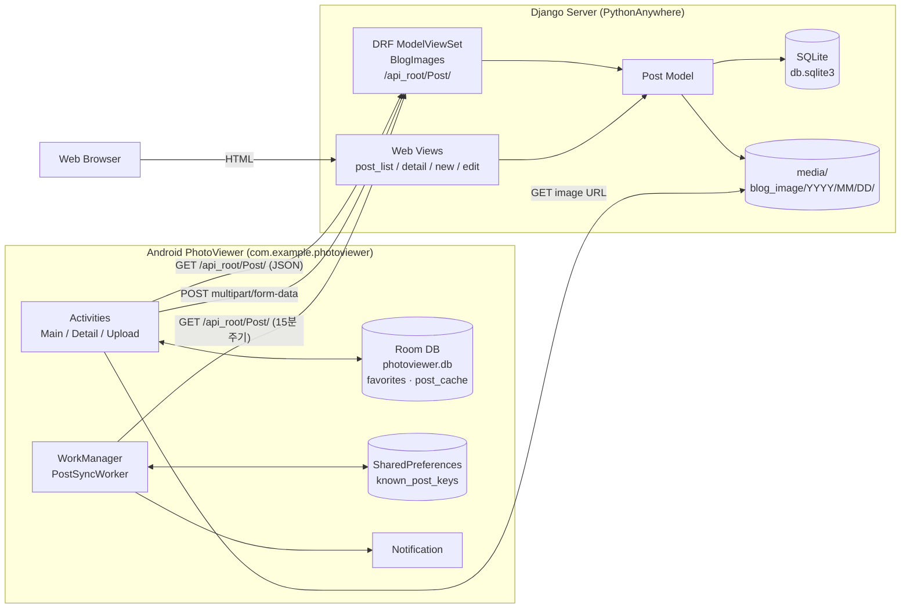
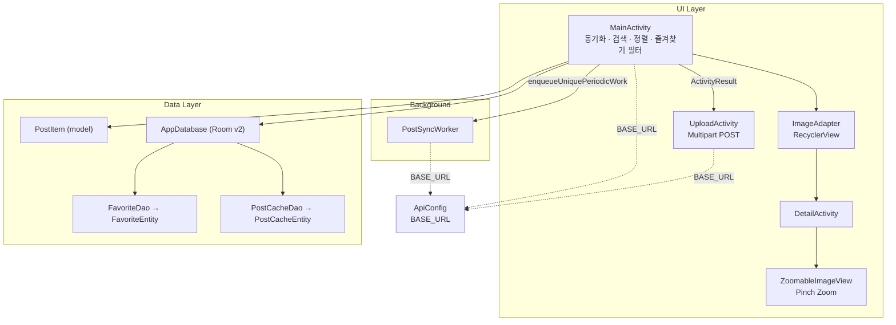
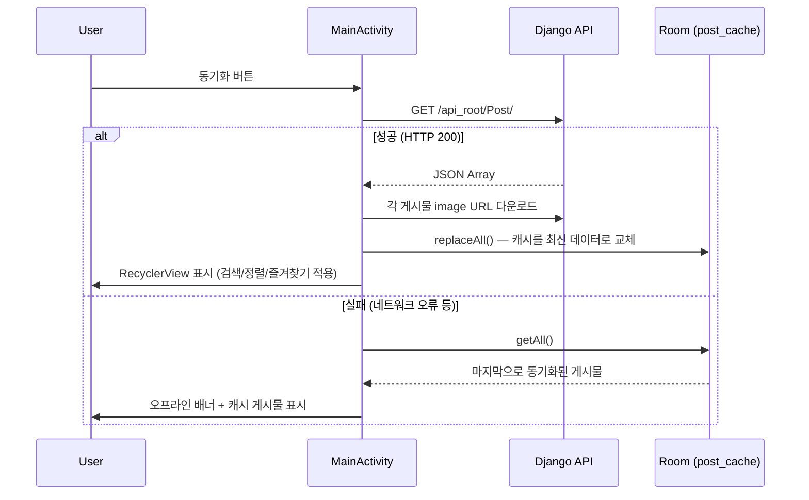
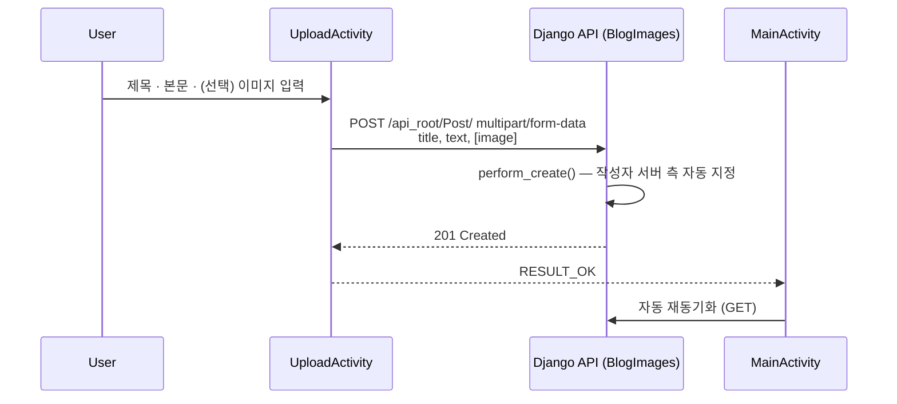
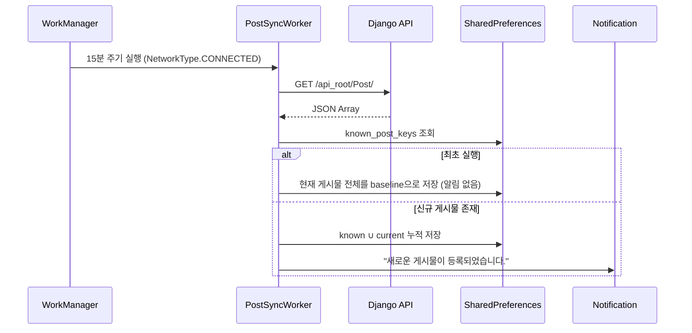

# Mobile-Webservice Photo Blog

Django REST Framework 기반 **Photo Blog Server**와 Android **PhotoViewer Client**를 연동한 모바일/웹서비스 프로젝트입니다.
서버는 PythonAnywhere에 배포되어 있으며, Android 앱은 REST API로 게시물과 이미지를 동기화하고 새 게시물을 업로드합니다.

- **Cloud Server**: https://hoynola.pythonanywhere.com
- **REST API**: https://hoynola.pythonanywhere.com/api_root/Post/

---

## 목차

1. [Architecture](#architecture)
2. [Tech Stack](#tech-stack)
3. [Project Structure](#project-structure)
4. [Django Server](#django-server)
5. [Android Client](#android-client)
6. [Additional Android Features](#additional-android-features)
7. [Getting Started](#getting-started)
8. [Testing](#testing)
9. [Cloud Deployment](#cloud-deployment)
10. [Repository Notes](#repository-notes)

---

## Architecture

### System Overview



- Android Client의 모든 서버 요청은 `ApiConfig.BASE_URL` **한 곳**만 참조합니다 (`MainActivity`, `UploadActivity`, `PostSyncWorker`).
- 서버는 같은 `Post` 모델을 **REST API**(Android용)와 **Django Template Web View**(브라우저용) 두 경로로 제공합니다.

### Android Client 내부 구조



### 주요 데이터 흐름

#### 1) 게시물 동기화 + 오프라인 캐시



#### 2) 게시물 업로드



#### 3) 백그라운드 동기화 + 알림



### 게시물 식별 키

REST API 응답(`PostSerializer`)에는 `id` 필드가 없으므로, Android는 서버 ID를 임의로 만들지 않고
**`created_date`를 게시물 식별 키(`postKey`)** 로 사용합니다.
`created_date`는 생성 시 1회만 설정되고 `post_edit` 등 어떤 경로에서도 바뀌지 않기 때문입니다.
즐겨찾기(`favorites`), 오프라인 캐시(`post_cache`), 백그라운드 신규 게시물 판별이 모두 같은 키 체계를 사용합니다.

---

## Tech Stack

| 구분 | 기술 |
| --- | --- |
| Server | Python 3.9+, Django 4.2, Django REST Framework 3.16, Pillow, SQLite |
| Server Test | Django `TestCase` / DRF `APITestCase`, coverage.py |
| Deployment | PythonAnywhere (WSGI, HTTPS) |
| Android | Java 11, minSdk 24 / targetSdk 36, AGP 8.11 |
| Android Libraries | AppCompat, Material, RecyclerView, Room 2.6, WorkManager 2.9 |
| Networking | `HttpURLConnection` + `org.json` (외부 HTTP 라이브러리 미사용) |
| Tools | Python Socket Server (요청 검증용) |

---

## Project Structure

```text
Mobile-Webservice/
├── PhotoBlogServer/                 # Django + DRF Server
│   ├── mysite/                      # Django project (settings, urls, wsgi)
│   ├── blog/                        # Django app
│   │   ├── models.py                # Post 모델
│   │   ├── serializers.py           # PostSerializer
│   │   ├── views.py                 # BlogImages(ViewSet) + Web Views
│   │   ├── forms.py                 # PostForm
│   │   ├── urls.py                  # Web 라우트 + DRF Router
│   │   ├── tests.py                 # 자동 회귀 테스트 (28개)
│   │   ├── templates/blog/          # base / post_list / post_detail / post_edit
│   │   └── static/blog/css/         # style.css
│   ├── manage.py
│   ├── requirements.txt
│   └── .coveragerc
├── PhotoViewer/                     # Android Client
│   └── app/src/main/
│       ├── java/com/example/photoviewer/
│       │   ├── ApiConfig.java       # 서버 주소 (BASE_URL)
│       │   ├── MainActivity.java
│       │   ├── DetailActivity.java
│       │   ├── UploadActivity.java
│       │   ├── ImageAdapter.java
│       │   ├── ZoomableImageView.java
│       │   ├── model/PostItem.java
│       │   ├── database/            # AppDatabase, Favorite*, PostCache*
│       │   └── worker/PostSyncWorker.java
│       ├── res/                     # layout, drawable, values, xml
│       └── AndroidManifest.xml
├── tools/
│   ├── socket_server.py             # Android HTTP Request 확인용 Socket Server
│   └── captured_requests/           # 수신한 Raw Request 저장
├── docs/                            # 과제 요구사항, 구현 계획, 기능 설계, 보고서 체크리스트
├── CLAUDE.md
└── README.md
```

---

## Django Server

### Post Model

| Field | Type | 비고 |
| --- | --- | --- |
| `author` | `ForeignKey(User)` | 서버가 자동 지정 (API에서는 read-only) |
| `title` | `CharField(200)` | 필수 |
| `text` | `TextField` | 필수 |
| `created_date` | `DateTimeField` | 기본값 `timezone.now` |
| `published_date` | `DateTimeField` | nullable |
| `image` | `ImageField` | 선택, `blog_image/%Y/%m/%d/`에 저장 |

### REST API

`BlogImages`(`ModelViewSet`)를 DRF `DefaultRouter`에 `Post`로 등록했습니다.

| Method | Endpoint | 설명 |
| --- | --- | --- |
| `GET` | `/api_root/` | API Root |
| `GET` | `/api_root/Post/` | 게시물 목록 (JSON Array) |
| `POST` | `/api_root/Post/` | 게시물 생성 (`multipart/form-data`: `title`, `text`, `image`(선택)) |
| `GET` | `/api_root/Post/<id>/` | 게시물 상세 |

응답 예시:

```json
[
  {
    "author": 1,
    "title": "제목",
    "text": "본문",
    "created_date": "2026-10-09T02:49:20.498404Z",
    "published_date": null,
    "image": "https://hoynola.pythonanywhere.com/media/blog_image/2026/10/09/photo.jpg"
  }
]
```

**작성자 자동 지정** (`BlogImages.perform_create`)

Android Client는 로그인 기능이 없으므로 `author`를 직접 보내지 않습니다. 서버는 다음 순서로 작성자를 결정합니다.

1. 로그인된 요청이면 `request.user`
2. 아니면 가장 먼저 생성된 superuser
3. superuser가 없으면 가장 먼저 생성된 사용자
4. 사용자가 하나도 없으면 `mobile_uploader` 계정을 자동 생성

특정 PK를 하드코딩하지 않으므로 빈 DB 환경에서도 업로드가 실패하지 않습니다.

### Web Views

| URL | View | 설명 |
| --- | --- | --- |
| `/` | `post_list` | 게시물 목록 (최신순) |
| `/post/<pk>/` | `post_detail` | 게시물 상세 |
| `/post/new/` | `post_new` | 게시물 작성 (로그인 필요) |
| `/post/<pk>/edit/` | `post_edit` | 게시물 수정 (로그인 필요) |
| `/admin/` | Django Admin | 로그인 화면은 작성/수정 페이지 로그인에도 재사용 (`LOGIN_URL`) |

---

## Android Client

| 컴포넌트 | 역할 |
| --- | --- |
| `ApiConfig` | 서버 주소 `BASE_URL` 상수 (현재 PythonAnywhere) |
| `MainActivity` | GET 동기화, 이미지 다운로드, 검색/정렬/즐겨찾기 필터, 오프라인 캐시, WorkManager 등록 |
| `ImageAdapter` | RecyclerView 게시물 카드, 즐겨찾기 토글, 상세 화면 이동 |
| `DetailActivity` | 제목·본문·날짜·이미지 상세 표시 |
| `ZoomableImageView` | `ScaleGestureDetector` 기반 Pinch Zoom |
| `UploadActivity` | 이미지 선택(선택 사항) 후 Multipart POST 업로드 |
| `PostItem` | API 응답 1건 모델, 표시 날짜/정렬 키/`postKey` 제공 |
| `AppDatabase` | Room DB (v2, `MIGRATION_1_2`로 기존 즐겨찾기 보존) |
| `FavoriteEntity` / `FavoriteDao` | 즐겨찾기 저장 |
| `PostCacheEntity` / `PostCacheDao` | 마지막 동기화 결과 오프라인 캐시 |
| `PostSyncWorker` | 주기적 신규 게시물 확인 및 Notification |

**네트워크 보안 설정**: `network_security_config.xml`에서 로컬 개발용 `10.0.2.2`, `127.0.0.1`만 HTTP(cleartext)를 허용하고,
그 외 도메인(PythonAnywhere 포함)은 Android 기본 정책(HTTPS)을 따릅니다.

**권한**: `INTERNET`, `POST_NOTIFICATIONS`(Android 13+ 런타임 요청, 거부해도 앱은 정상 동작)

---

## Additional Android Features

| ID | 기능 | 핵심 구현 |
| --- | --- | --- |
| 14-1 | 검색 | 제목/본문 실시간 검색, 서버 재호출 없이 로컬 목록 필터링 |
| 14-2 | 정렬 | `published_date`(없으면 `created_date`) 기준 최신순/오래된순, 검색·즐겨찾기 필터와 동시 적용 |
| 14-3 | 즐겨찾기 | Room `favorites` 테이블, 즐겨찾기만 보기 필터, 앱 재실행 후에도 유지 |
| 14-4 | 오프라인 캐시 | Room `post_cache` 테이블, 서버 실패 시 캐시 로드 + 오프라인 배너 |
| 14-5 | 백그라운드 동기화 & 알림 | WorkManager `PeriodicWorkRequest`(15분, `NetworkType.CONNECTED`) + Notification |

### 1. Search

제목과 본문을 기준으로 실시간 검색합니다.
서버를 다시 호출하지 않고 이미 받아온 목록에서 필터링하며, 검색어를 지우면 전체 목록으로 복원됩니다.

### 2. Sort

최신순/오래된순으로 정렬할 수 있으며, 검색 및 즐겨찾기 필터와 함께 사용할 수 있습니다.
정렬 기준은 `published_date`(없으면 `created_date`)입니다.

### 3. Favorites

게시물별 즐겨찾기를 설정하고 즐겨찾기 게시물만 필터링할 수 있습니다.
Room에 저장하므로 앱을 종료한 뒤 다시 실행해도 상태가 유지됩니다.

### 4. Offline Cache

동기화에 성공할 때마다 게시물 데이터를 Room 캐시에 통째로 교체 저장합니다.
서버에 연결할 수 없으면 캐시된 게시물을 불러오며, 오프라인 상태에서도 검색, 정렬, 즐겨찾기, 상세보기를 사용할 수 있습니다.
(이미지 Bitmap은 저장하지 않고 URL만 보관합니다.)

### 5. Background Sync & Notification

`PostSyncWorker`가 앱이 실행 중이지 않아도 주기적으로 서버를 확인합니다.

- `PeriodicWorkRequest` 15분 주기 (WorkManager 최소 주기), `ExistingPeriodicWorkPolicy.KEEP`
- `NetworkType.CONNECTED` 조건
- 최초 실행 시 기존 게시물을 baseline으로 저장하여 불필요한 알림 방지
- 확인한 게시물 키를 누적 저장하여 중복 알림 방지
- 테스트용 즉시 실행 `OneTimeWorkRequest` 지원

---

## Getting Started

### Django Server (Local)

```bash
cd PhotoBlogServer

python3 -m venv venv
source venv/bin/activate

pip install -r requirements.txt
python manage.py migrate
python manage.py createsuperuser   # Web 작성/수정 및 Admin 로그인용 (선택)

python manage.py runserver
```

| 대상 | 주소 |
| --- | --- |
| Web | http://127.0.0.1:8000/ |
| REST API | http://127.0.0.1:8000/api_root/Post/ |
| Android Emulator → Local Server | http://10.0.2.2:8000 |

### Android Client

1. Android Studio에서 `PhotoViewer/` 폴더를 엽니다.
2. 서버 주소를 확인합니다. 기본값은 Cloud Server입니다.

   ```java
   // PhotoViewer/app/src/main/java/com/example/photoviewer/ApiConfig.java
   public static final String BASE_URL = "https://hoynola.pythonanywhere.com";
   ```

   로컬 서버로 테스트하려면 이 한 줄만 `"http://10.0.2.2:8000"`으로 변경합니다.
   (`MainActivity`, `UploadActivity`, `PostSyncWorker`가 모두 이 상수만 참조하므로 다른 파일은 수정할 필요가 없습니다.)
3. Emulator 또는 실기기에서 실행합니다.

---

## Testing

### Automated Regression Tests (Django)

```bash
cd PhotoBlogServer

coverage erase
coverage run manage.py test blog
coverage report -m
coverage html        # → PhotoBlogServer/htmlcov/index.html
```

현재 결과:

```text
Ran 28 tests
OK

TOTAL    96 statements    0 missing    100%
```

Coverage 측정 범위는 `blog` 앱입니다 (`migrations`, `tests.py` 제외, `.coveragerc` 참고).

| Test Class | 검증 내용 |
| --- | --- |
| `PostApiTests` (15) | 목록/상세 조회, JSON 구조, 게시물 생성, 이미지 업로드, 클라이언트 `author` 무시, 로그인 사용자 작성자 지정, 사용자 미존재 시 기본 작성자 생성, 필수 필드 400, 없는 게시물 404 |
| `PostWebViewTests` (11) | 목록/상세 페이지, 404, 비로그인 작성/수정 접근 제한, 로그인 작성(이미지 포함), 수정 |
| `PostModelTests` (2) | `Post.publish()`, `Post.__str__()` |

### Socket Request Test

Android Client가 실제로 보내는 HTTP Request를 확인하기 위한 Raw Socket Server입니다.

```bash
python tools/socket_server.py 9000
```

`ApiConfig.BASE_URL`을 임시로 `http://10.0.2.2:9000`으로 바꾸고 동기화를 누르면, 수신한 요청이 화면에 출력되고 `tools/captured_requests/`에 저장됩니다.

```http
GET /api_root/Post/ HTTP/1.1
Host: 10.0.2.2:9000
Connection: Keep-Alive
Accept-Encoding: gzip
```

---

## Cloud Deployment

Django Server는 PythonAnywhere에 배포되어 있습니다.

```text
https://hoynola.pythonanywhere.com
```

- `ALLOWED_HOSTS`에 `.pythonanywhere.com` 포함
- `STATIC_ROOT = staticfiles/` — `python manage.py collectstatic` 후 PythonAnywhere Static files 매핑으로 Admin CSS/JS 서빙
- `MEDIA_ROOT = media/` — 업로드 이미지 저장 위치

Cloud 환경에서 다음 기능의 정상 동작을 확인했습니다.

- Django Web Page / REST API
- Android 게시물 동기화 및 Cloud 이미지 다운로드
- 게시물 상세보기
- Android Multipart Upload 및 업로드 후 자동 재동기화
- WorkManager 백그라운드 동기화 및 신규 게시물 Notification

---

## Repository Notes

Django Server와 Android Client는 하나의 Repository에서 함께 관리합니다.
다음 파일 및 디렉터리는 Git에 포함하지 않습니다 (`.gitignore`).

```text
venv/  .venv/  __pycache__/  .env
PhotoBlogServer/db.sqlite3
PhotoBlogServer/media/
PhotoBlogServer/.coverage
PhotoBlogServer/htmlcov/
PhotoBlogServer/staticfiles/
.gradle/  **/build/  local.properties  .idea/  *.iml
```
